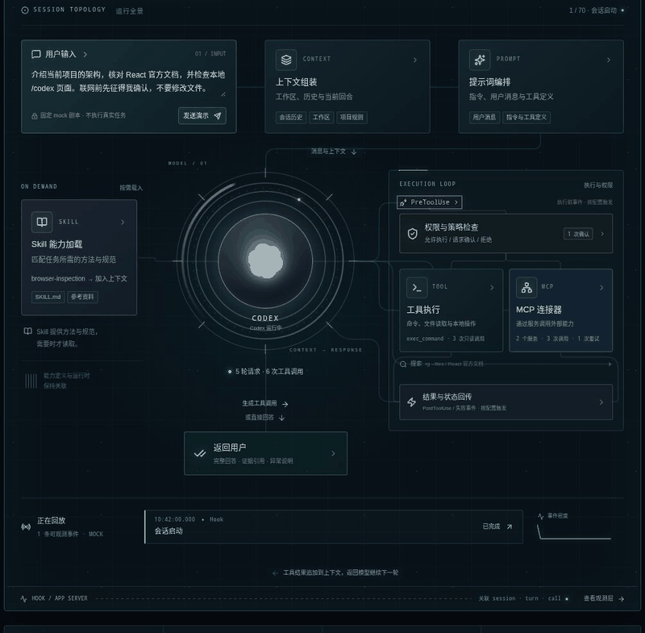

# Agent Matrix · Neural Tree

面向 Codex 与 Claude Code 的本地运行时观测站。通过 Hook、Codex app-server 和本机统计元数据，将会话、模型请求、工具调用、权限及结果关联到 2D / 3D 拓扑。

基于 TypeScript、React、Vite、Express、WebSocket 和 Three.js。

## 动态原型



上图来自 `/codex/prototype` 的虚构演示会话，展示运行链路与光流效果；不包含真实本地会话数据。原型中的审批、记忆、容量和费用等示例不能视为已实现的真实 Agent 控制能力。

## 快速启动

需要 Node.js 20 或更新版本。

```bash
npm install
npm run dev
```

打开 <http://localhost:3000>。主服务默认监听 3000；内嵌 Claude 和 Codex Hook 网关分别使用本机回环端口 7788、7789。真实运行页没有事件时显示等待状态，模拟演示通过独立路由进入。

| 页面 | 路径 |
| --- | --- |
| Codex 2D 观测站 | `/codex` |
| Codex 3D 拓扑 | `/codex/3d` |
| Codex 会话链路 | `/codex/runtime` |
| Claude Code 2D 观测站 | `/claude` |
| Claude Code 3D 拓扑 | `/claude/3d` |
| Claude Code 会话链路 | `/claude/runtime` |
| Claude Desktop 本地统计 | `/claude/desktop` |
| 2D / 3D 演示原型 | `/codex/prototype`、`/codex/prototype/3d` |

## 接入真实运行时

### Claude Code

在本项目根目录执行：

```bash
npm run configure:claude-runtime
```

脚本幂等合并项目 `.claude/settings.json`，保留已有配置与 Hook。已有 JSON 无法解析时拒绝覆盖。command Hook 将提示提交、工具前后、失败、权限、压缩、子代理及停止等生命周期事件发送到 `127.0.0.1:7788/hook/claude`。

本地 transcript 统计补充模型、推理档位、Token、请求数、明确记录的回合时长、规则快照文件条目数、系统指令分段数、工具定义数及工具调用状态。统计按 session、用户回合和父链关联；工具调用按 ID 合并，快照标明本回合或会话继承来源。

统计读取器仅保留元数据，不缓存或返回 transcript 提示词、回答、规则正文、原始路径、工具参数、工具结果或 schema。已有 Hook 链路可展示脱敏后的用户输入与最终答复；二者的数据边界不同。设置 `CLAUDE_DESKTOP_TELEMETRY_DISABLED=1` 可关闭本地 transcript 统计读取。

### Codex

仓库 `.codex/hooks.json` 配置官方生命周期 Hook。启动服务后，在 Codex 中运行 `/hooks`，审核并信任 `Agent Matrix local Codex runtime telemetry`。信任后才会向 `127.0.0.1:7789` 上报事件。

Codex Hook 与 app-server 适配器补充会话、回合、工具、权限和结果证据；本地 rollout 用量用于资源统计。托管搜索及其他能力是否可见取决于实际接入的数据源，不会用演示事件补齐。

### Claude Desktop

`/claude/desktop` 仅展示本地日志中明确标为 `claude-desktop-3p` 的统计，和 Code 来源分开处理。普通 Desktop Chat 没有受支持记录时保持未接入，不推断已采集。

## 观测能力与边界

- **共享观测站**：Codex、Claude 与后续 Agent 通过插件声明路由、事件映射、遥测加载和品牌视觉，共用 2D / 3D、资源面板和详情组件。
- **真实用量**：展示当前回合 Token、缓存分项、实际请求数和最近一次请求输入；最近输入与累计用量分开统计。
- **元数据来源**：规则、提示词结构和工具结果标记可由 transcript 补充；实际调用与可用工具定义数分别统计。
- **未知值保留**：无可靠来源的窗口容量、推理 Token、排队深度、重试次数或 Skill 正文不按 0 或模型名称推算。
- **记忆统计**：当前项目 memory 文件数量、大小和更新时间只说明文件存在，不代表已载入模型或实际使用。
- **事件与动效**：新增证据进入有限视觉队列，优先展示输入、快照与请求阶段；密集工具动效会合并省略，完整记录保留在事件轨迹。光流单次播放，首次打开不自动回放历史。快照与请求统计触发的提示标为统计派生，不代表已捕获内部执行过程。纯生命周期事件不自动代表内部上下文组装或成功工具执行。
- **本地隐私**：真实事件接口限制本机访问；统计接口校验本地 Host / Origin。隐藏推理与凭据不进入展示。

脱敏 Hook 历史保存在 `.codex/runtime-events.jsonl`、`.claude/runtime-events.jsonl`，重启后可恢复；这些日志已被 Git 忽略。Hook 前后采样间隔不等于工具实际执行时长。

## 开发与验证

```bash
npm run lint
npm run build
npm run test:claude-runtime
npm run test:codex-runtime
npm run test:codex-prototype
npm run test:runtime-observation
npm run test:runtime-views
```

VS Code / Cursor 扩展位于 `vscode-extension/`，使用方式见其 [README](vscode-extension/README.md)。

相关设计：

- [Claude 运行时与元数据边界](docs/design/claude-runtime.md)
- [共享观测站插件接口](docs/design/runtime-observatory-plugins.md)

## 许可证

[Apache License 2.0](https://www.apache.org/licenses/LICENSE-2.0)。第三方图标归属见 [THIRD_PARTY_NOTICES.md](THIRD_PARTY_NOTICES.md)。
